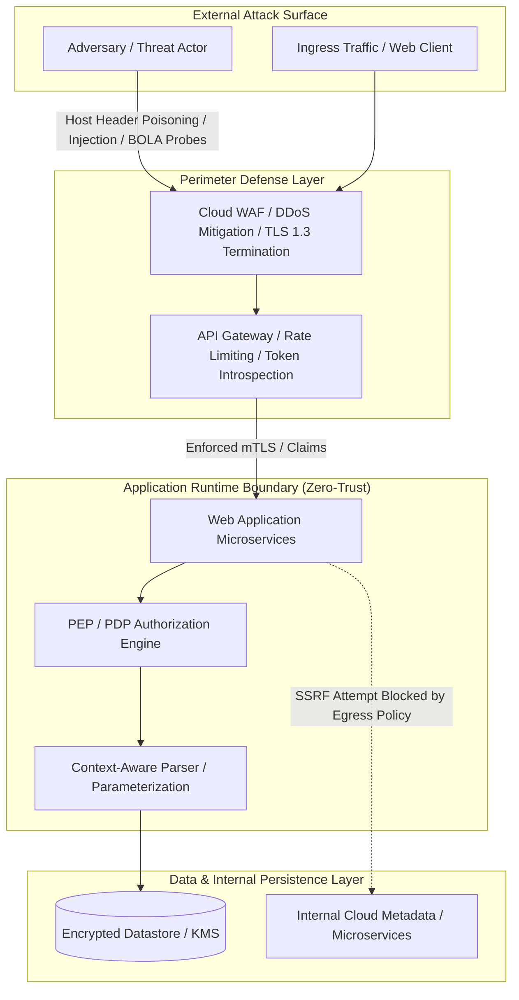

# TECHNICAL BRIEF: MODERN WEB APPLICATION SECURITY & THREAT RESILIENCE
**Engineering Guide to Vulnerability Vectors, Defense-in-Depth Architectures, and Zero-Trust Mitigation**

---

| **Document Metadata** | **Specification** |
|:---|:---|
| **Document Classification** | Technical Brief & Engineering Security Guide (3-Page Executive & Technical Reference) |
| **Domain** | Web Application Security, Cloud-Native Architecture, Application Security (AppSec) |
| **Target Audience** | Software Engineers, Security Architects, DevOps/DevSecOps Engineers, Technical Leadership |
| **Framework Alignment** | OWASP Top 10:2021, OWASP API Security Top 10:2023, OWASP ASVS v4.0.3, NIST SP 800-95 |
| **Version & Status** | v1.1.0 (Final Release) |

---

## 1. PURPOSE AND EXECUTIVE SUMMARY

### 1.1 Purpose
Modern web applications represent the primary interface between enterprise data assets and global users. As architectural paradigms have shifted from monolithic client-server topologies to distributed microservices, single-page applications (SPAs), and cloud-native API fabrics, the attack surface has expanded exponentially. The purpose of this technical brief is to deliver an authoritative, structured, and pragmatic security reference that bridges high-level threat modeling with low-level implementation safeguards, specifically addressing common web application risks using the OWASP Top 10 as a foundational baseline.

### 1.2 Executive Summary
Web application breaches in contemporary production environments rarely stem from cryptographic library collapses or esoteric zero-day kernel exploits; instead, they overwhelmingly exploit fundamental flaws in **business logic**, **broken access control (BAC)**, **insecure API design**, and **security misconfigurations**. According to Verizon's Data Breach Investigations Report (DBIR) and OWASP telemetry, web application attack surfaces account for over 70% of externally facing enterprise breaches. 

This brief synthesizes core vulnerability vectors, dissects how they arise and their business impact, and presents practical defensive controls rooted in secure design and prevention-first engineering.



---

## 2. DEEP DIVE: FIVE CORE OWASP RISKS, MECHANISMS, IMPACTS & DEFENSES

Securing modern web systems requires understanding how vulnerabilities arise at the code and architectural levels, their technical and business consequences, and the concrete defensive engineering controls that neutralize them.

```mermaid
mindmap
  root((OWASP Top 10<br/>Core Vectors))
    A01: Broken Access Control
      How It Arises: Unscoped object queries, BOLA/IDOR, path traversal
      Impact: Mass data leakage, account takeover, horizontal escalation
      Defenses: Server-side scoping, ABAC/RBAC, UUIDv4, deny-by-default
    A02: Cryptographic Failures
      How It Arises: Weak hashing (MD5), plain HTTP, hardcoded secrets
      Impact: Credential theft via MitM, compliance fines (PCI/GDPR)
      Defenses: Argon2id/PBKDF2, TLS 1.3 with PFS, KMS secret management
    A03: Injection Flaws
      How It Arises: Dynamic SQL concatenation, template string interpolation
      Impact: Full database exfiltration, host Remote Code Execution (RCE)
      Defenses: Parameterized prepared statements, typed ORMs, context escaping
    A04: Insecure Design
      How It Arises: Lack of threat modeling, flawed business logic, race conditions
      Impact: Financial balance manipulation, bot scalping, business fraud
      Defenses: STRIDE modeling, state machines, server-side invariant checks
    A05: Security Misconfiguration
      How It Arises: Default credentials, stack traces, missing security headers
      Impact: System reconnaissance, Clickjacking, MIME confusion
      Defenses: Hardened IaC baselines, CSP/HSTS headers, stripped banners
```

---

### 2.1 Risk 1: Broken Access Control (OWASP A01:2021)

#### A. How It Arises
Broken Access Control occurs when an application fails to enforce authorization boundaries between users and resources. In modern REST and GraphQL APIs, this manifests predominantly as **Broken Object Level Authorization (BOLA / IDOR)**. When an endpoint accepts a user-supplied object identifier (e.g., `GET /api/v1/invoices/84920`) without validating whether the authenticated session owns or is authorized to view that record, attackers simply increment or iterate the identifier to view other users' private data. It also arises through forced browsing to unlinked administrative endpoints (`/admin/dashboard`) where access decisions rely on client-side UI hiding rather than server-side enforcement.

#### B. Potential Impact
- **Mass Data Exfiltration**: Adversaries write simple automated scripts to iterate IDs and dump entire databases of customer PII, medical records, or financial statements.
- **Horizontal & Vertical Privilege Escalation**: Normal users assume administrative capabilities or impersonate other tenants.
- **Regulatory Penalties**: Severe GDPR, HIPAA, and CCPA regulatory fines due to systematic privacy violations.

#### C. Practical Defensive Controls (Prevention & Secure Design)
1. **Enforce Tenant-Scoped Data Queries**: Never fetch database records solely by object ID. Always scope the persistence query using the authenticated tenant or user ID extracted from the verified server-side session:
   ```python
   # Secure Pattern: Tenant-scoped persistence query
   def get_document(current_user: UserSession, doc_id: int):
       doc = db.session.query(Document).filter(
           Document.id == doc_id,
           Document.tenant_id == current_user.tenant_id  # Enforced tenant boundary
       ).first()
       if not doc:
           raise NotFoundException("Resource not found.")
       return doc
   ```
2. **Deny by Default**: Configure routing frameworks and API gateways to deny all traffic by default, requiring explicit permission decorators on every endpoint.
3. **Adopt Policy as Code (ABAC)**: Decouple authorization logic using Attribute-Based Access Control frameworks (e.g., Open Policy Agent or Cedar) to enforce fine-grained contextual rules.

---

### 2.2 Risk 2: Cryptographic Failures (OWASP A02:2021)

#### A. How It Arises
Formerly termed "Sensitive Data Exposure," this category focuses on root-cause cryptographic weaknesses. Flaws arise when applications transmit data over unencrypted HTTP (permitting Wi-Fi eavesdropping), utilize deprecated cryptographic primitives (e.g., MD5, SHA-1, DES, or RC4), hardcode cryptographic keys and API tokens directly in source control repositories, or use fast, un-salted hashing algorithms for passwords (allowing instant precomputed rainbow table lookups).

#### B. Potential Impact
- **Credential Harvesting & Session Hijacking**: Eavesdroppers intercept plaintext credentials or session cookies via Man-in-the-Middle (MitM) attacks.
- **Total Loss of Data Confidentiality**: Exposure of sensitive intellectual property, personally identifiable information (PII), or payment card data (PCI-DSS non-compliance).

#### C. Practical Defensive Controls (Prevention & Secure Design)
1. **Mandate Modern Password Key Derivation**: Hash all passwords using memory-hard or computationally expensive functions: **Argon2id** (memory $\ge 64\,\text{MB}$, iterations $\ge 3$) or **PBKDF2-HMAC-SHA256** ($\ge 600,000$ iterations) with a unique, cryptographically random 16-byte salt per user.
2. **Enforce Strict Transport Layer Security (TLS 1.3)**: Disable deprecated protocols (SSLv3, TLS 1.0, TLS 1.1) and enforce Perfect Forward Secrecy (PFS) cipher suites. Deploy the `Strict-Transport-Security` header with `max-age=63072000; includeSubDomains; preload`.
3. **Decouple Secrets from Code**: Utilize dedicated Key Management Services (AWS KMS, HashiCorp Vault, GCP Secret Manager) and pre-commit secret detection hooks (e.g., Gitleaks) to prevent hardcoded keys.

---

### 2.3 Risk 3: Injection Flaws (OWASP A03:2021)

#### A. How It Arises
Injection occurs when untrusted user data is concatenated directly into an interpreter (SQL, NoSQL, OS command shell, LDAP, or template engine) without proper sanitization or parameterization. For example, in SQL injection, input containing quote characters (`' OR 1=1; --`) alters the parser's abstract syntax tree. In Server-Side Template Injection (SSTI), user-supplied strings passed into template renderers (`render_template_string(f"Hello {user_input}")`) allow attackers to evaluate arbitrary Python/Ruby/Java expressions and escape sandboxes. Cross-Site Scripting (XSS), now merged into A03, arises when unescaped HTML/JavaScript is reflected back to user browsers.

#### B. Potential Impact
- **Arbitrary Remote Code Execution (RCE)**: Attackers break out of template engines or invoke shell subprocesses, taking over the underlying host or container.
- **Database Compromise & Data Tampering**: Complete read, write, and deletion privileges over database tables, bypassing authentication entirely.
- **Client-Side Session Theft**: XSS enables adversaries to hijack authenticated sessions via cookie theft or inject phishing overlays.

#### C. Practical Defensive Controls (Prevention & Secure Design)
1. **Mandatory Parameterized Prepared Statements**: Maintain an absolute architectural separation between executable code and untrusted data:
   ```python
   # Secure Pattern: Parameterized query binding
   cursor.execute(
       "SELECT id, username, email FROM users WHERE username = %s AND active = %s",
       (user_input, True)
   )
   ```
2. **Context-Aware Output Encoding & Auto-Escaping**: Utilize modern templating and front-end frameworks (e.g., React, Angular, Jinja2 autoescape) that escape HTML characters (`&`, `<`, `>`, `"`, `'`) by default.
3. **Strict Content Security Policy (CSP)**: Deploy a robust CSP (`default-src 'self'; script-src 'self' 'nonce-...'; object-src 'none'`) to neutralize inline script execution even if an injection flaw occurs.

---

### 2.4 Risk 4: Insecure Design (OWASP A04:2021)

#### A. How It Arises
Insecure Design represents a fundamental paradigm shift in the OWASP Top 10, distinguishing between *implementation defects* (bugs in code) and *architectural design flaws* (missing security controls in the system design). It arises when software is built without threat modeling, fails to account for adversarial business logic flows, lacks rate limiting on critical financial or credential reset functions, or assumes that client-side validations cannot be bypassed. A classic example is an e-commerce checkout flow where product price is submitted via a client-side POST body and trusted by the server without re-verifying against the product catalog database.

#### B. Potential Impact
- **Business Logic Subversion**: Threat actors manipulate transaction amounts (e.g., purchasing goods for negative or zero dollars), scalp tickets via automated bot scripts, or exploit race conditions in balance withdrawals.
- **Exhaustion of Financial & System Resources**: Unbounded consumption of SMS verification APIs or cloud compute quotas (Denial of Wallet).

#### C. Practical Defensive Controls (Prevention & Secure Design)
1. **Embed STRIDE Threat Modeling in Design Phase**: Systematically model threats (Spoofing, Tampering, Repudiation, Information Disclosure, Denial of Service, Elevation of Privilege) during sprint planning before any code is written.
2. **Enforce Server-Side Invariants & State Machines**: Never trust data originating from client front-ends. Enforce state machine transitions (e.g., `Cart -> PaymentPending -> Confirmed`) on the server, validating that monetary prices and discount codes are computed strictly server-side.
3. **Rate Limiting & Anti-Automation Controls**: Protect all sensitive business flows (e.g., coupon redemption, password reset, checkout) using Token Bucket or Leaky Bucket algorithms enforced at the API gateway layer.

---

### 2.5 Risk 5: Security Misconfiguration (OWASP A05:2021)

#### A. How It Arises
With the rapid adoption of cloud infrastructure, containers, and complex CI/CD pipelines, security misconfiguration has become ubiquitous. It arises when services are deployed with default accounts and passwords, cloud storage buckets (AWS S3, GCP Cloud Storage) are left publicly readable or writable, verbose debug modes remain enabled in production (leaking internal stack traces and environment variables upon error), unnecessary HTTP methods (e.g., `TRACE`, `PUT`, `DELETE`) are left open, or required security response headers are completely omitted.

#### B. Potential Impact
- **Reconnaissance & Vulnerability Chaining**: Detailed stack traces disclose framework versions, database schemas, internal IP addresses, and file paths, facilitating targeted zero-day exploits.
- **Client-Side Attacks**: Absence of `X-Frame-Options` enables Clickjacking attacks; missing `X-Content-Type-Options` enables MIME confusion attacks.
- **Cloud Perimeter Exposure**: Publicly exposed storage buckets or database management consoles lead to immediate corporate data leaks.

#### C. Practical Defensive Controls (Prevention & Secure Design)
1. **Hardened Infrastructure as Code (IaC) Baselines**: Define all cloud resources, containers, and web servers using declarative IaC templates (Terraform, Ansible) audited against CIS Benchmarks using static scanners (e.g., Trivy, Checkov).
2. **Automated Error Masking Middleware**: Implement centralized global exception handlers that log diagnostic details internally to a secure SIEM while returning opaque, generic error responses to clients:
   ```json
   {"error": "An unexpected error occurred. Request ID: 550e8400-e29b-41d4-a716-446655440000"}
   ```
3. **Enforce Complete HTTP Security Header Suite**: Ensure every reverse proxy, API gateway, or web daemon injects the mandatory browser defense headers (`CSP`, `HSTS`, `X-Content-Type-Options: nosniff`, `X-Frame-Options: DENY`, `Permissions-Policy`).

---

### 2.6 Bonus Cloud-Native Vector: Server-Side Request Forgery (OWASP A10:2021)

#### A. How It Arises
In cloud-native architectures, applications frequently accept user-supplied URLs to fetch external avatars, process webhooks, or import remote documents. When backend HTTP clients blindly execute `GET` requests to these URLs without resolving the hostname and validating the target IP address, attackers supply link-local metadata endpoints (`http://169.254.169.254`) or internal RFC 1918 private subnets.

#### B. Potential Impact
Adversaries exfiltrate temporary cloud IAM role credentials directly from the Instance Metadata Service (IMDS), enabling initial access and lateral movement across the organization's entire cloud infrastructure.

#### C. Practical Defensive Controls (Prevention & Secure Design)
- **Application Layer**: Parse incoming URLs, resolve hostnames via DNS, and verify that the target IP is routable on the public internet (rejecting `127.0.0.0/8`, `10.0.0.0/8`, `172.16.0.0/12`, `192.168.0.0/16`, and `169.254.169.254`).
- **Cloud Infrastructure Layer**: Enforce IMDSv2 (requiring a session token via `PUT` headers) and set `http-put-response-hop-limit` to 1 on containerized workloads.

---

## 3. PRACTICAL IMPLEMENTATION: THE DEFENSE-IN-DEPTH BLUEPRINT

Securing modern web systems requires systematic engineering across the development lifecycle:

```
[Threat Modeling (STRIDE)] 
         ↓
[Secure Coding & Parameterization] 
         ↓
[CI/CD Static & Dynamic Verification (SAST/DAST/SCA)] 
         ↓
[Container & Runtime Hardening] 
         ↓
[Observability, SIEM & Automated Incident Response]
```

### Step 1: Enforce Strict HTTP Defense-in-Depth Headers
Every web application response must supply strict, hardened HTTP headers to neutralize browser-side exploitation vectors:

| HTTP Response Header | Recommended Production Value | Security Rationale |
|:---|:---|:---|
| `Content-Security-Policy` | `default-src 'self'; script-src 'self' 'nonce-RANDOM'; object-src 'none'; base-uri 'self'; frame-ancestors 'none';` | Eliminates unsanctioned inline script execution and unauthorized asset injection. |
| `Strict-Transport-Security` | `max-age=63072000; includeSubDomains; preload` | Forces HTTPS communication; blocks SSL-stripping and protocol downgrade attacks. |
| `X-Content-Type-Options` | `nosniff` | Prevents browsers from MIME-sniffing away from the declared content type. |
| `X-Frame-Options` | `DENY` | Neutralizes Clickjacking (UI redressing) in legacy clients. |
| `Permissions-Policy` | `camera=(), microphone=(), geolocation=(), payment=()` | Restricts hardware browser APIs from arbitrary exploitation. |
| `Cross-Origin-Opener-Policy` | `same-origin` | Isolates browsing context against Spectre-style side-channel leaks. |

### Step 2: Implement Cryptographically Robust Identity & Session Architecture
- **Password Storage**: Mandate modern memory-hard key derivation functions: **Argon2id** (memory cost $\ge 64\,\text{MB}$, iterations $\ge 3$, parallelism $= 4$) or **PBKDF2-HMAC-SHA256** ($\ge 600,000$ iterations). Ban MD5, SHA-1, and unsalted SHA-256.
- **Session Cookie Flags**: All session and authentication cookies must enforce:
  ```http
  Set-Cookie: __Host-SessionId=a7c93...; Secure; HttpOnly; SameSite=Strict; Path=/;
  ```
  The `__Host-` prefix enforces that the cookie is secure, sent only to the originating host, and scoped to the root path without subdomain contamination.
- **Token Validation**: In JWT implementations, explicitly verify the cryptographic signature against a secure public key (RS256 / EdDSA), reject the `none` algorithm, and strictly validate standard claims (`iss`, `aud`, `exp`, `nbf`).

### Step 3: Embed Automated Security Quality Gates into CI/CD Pipelines
Integrate automated testing into version control hooks and pull request pipelines:
1. **Static Application Security Testing (SAST)**: Employ AST-based scanners (e.g., Semgrep, Bandit, CodeQL) to catch dangerous sinks and unparameterized logic prior to merge.
2. **Software Composition Analysis (SCA)**: Scan third-party open-source libraries against the National Vulnerability Database (NVD) and GitHub Advisory Database to preempt vulnerable dependencies (OWASP A06:2021).
3. **Dynamic Application Security Testing (DAST)**: Run automated regression scanners against staging environments to detect runtime misconfigurations and unhandled HTTP exceptions.

---

## 4. CONCRETE IMPLEMENTATION SCENARIOS & CODE EVIDENCE

### Scenario A: Vulnerable vs. Secure Database Interaction
```python
# -------------------------------------------------------------------------
# VULNERABLE: Direct String Formatting enables SQL Injection (A03:2021)
# Attacker Payload in user_input: admin' --
# Resulting Query: SELECT * FROM accounts WHERE username = 'admin' --' AND active = 1
# -------------------------------------------------------------------------
cursor.execute(f"SELECT * FROM accounts WHERE username = '{user_input}' AND active = 1")

# -------------------------------------------------------------------------
# SECURE: Strongly-Typed Parameterized Prepared Statement
# Database engine treats parameters strictly as literal values, never executable SQL
# -------------------------------------------------------------------------
cursor.execute(
    "SELECT id, username, email, role FROM accounts WHERE username = %s AND active = %s",
    (user_input, True)
)
```

### Scenario B: Reflected Cross-Site Scripting (XSS) vs. Contextual Escaping
```javascript
// VULNERABLE: Direct DOM sink assignment permits script execution
// Attacker Payload: 
document.getElementById("greeting").innerHTML = "Welcome back, " + userProfile.name;

// SECURE: Context-aware text assignment forces browser parser to treat data as text
document.getElementById("greeting").textContent = "Welcome back, " + userProfile.name;
```

---

## 5. STRATEGIC RECOMMENDATIONS & CONCLUSION

### 5.1 Strategic Engineering Recommendations
1. **Adopt a "Shift-Left" Security Culture**: Train engineering squads on the OWASP Top 10 and secure coding standards. Security review must occur during design and pull request phases rather than post-deployment penetration testing.
2. **Implement Zero-Trust Internal Networking**: Terminate TLS at all microservice boundaries (mTLS via service meshes like Istio or Linkerd) and enforce strict authentication even between internal microservices.
3. **Establish Robust Security Observability**: Log all authentication events, authorization failures, input validation errors, and rate-limiting triggers with contextual user and tenant identifiers. Ship immutable logs to a centralized SIEM with automated alerting on anomalous access bursts.

### 5.2 Conclusion
Web application security is not a static endpoint or a binary checkmark; it is a continuous engineering discipline. By replacing ad-hoc perimeter defenses with systematic defense-in-depth, enforcing architectural scoping at data access layers, hardening transport and browser primitives, and continuously auditing code through automated pipelines, organizations can construct web systems that remain resilient against sophisticated, persistent adversaries.

---

## 6. CREDIBLE REFERENCES & STANDARDS

1. **OWASP Foundation**. (2021). *OWASP Top 10: 2021 Application Security Risks*. https://owasp.org/Top10/
2. **OWASP Foundation**. (2023). *OWASP API Security Top 10 2023*. https://owasp.org/www-project-api-security/
3. **OWASP Foundation**. (2021). *OWASP Application Security Verification Standard (ASVS) Version 4.0.3*. https://owasp.org/www-project-application-security-verification-standard/
4. **OWASP Foundation**. (2024). *OWASP Cheat Sheet Series*. https://cheatsheetseries.owasp.org/
5. **National Institute of Standards and Technology (NIST)**. (2020). *Security and Privacy Controls for Information Systems and Organizations* (NIST Special Publication 800-53, Rev. 5). U.S. Department of Commerce. https://doi.org/10.6028/NIST.SP.800-53r5
6. **National Institute of Standards and Technology (NIST)**. (2007). *Guide to Secure Web Services* (NIST Special Publication 800-95). U.S. Department of Commerce. https://doi.org/10.6028/NIST.SP.800-95
7. **Internet Engineering Task Force (IETF)**. (2022). *HTTP Semantics* (RFC 9110). https://datatracker.ietf.org/doc/html/rfc9110
8. **Cybersecurity and Infrastructure Security Agency (CISA)**. (2024). *Known Exploited Vulnerabilities (KEV) Catalog*. U.S. Department of Homeland Security. https://www.cisa.gov/known-exploited-vulnerabilities-catalog
