# ENTERPRISE WEB APPLICATION SECURITY: RISK-TO-MITIGATION MATRIX
**Exhaustive Vulnerability Vector Analysis, Threat Impact Modeling, and Multi-Tiered Defenses**

---

## 1. Matrix Overview & Governance Framework
This risk-to-mitigation table provides software engineering and cybersecurity teams with an actionable operational roadmap for identifying, evaluating, mitigating, and verifying web application vulnerabilities. 

Each threat vector is assessed across five structural dimensions:
1. **Threat Vector & Taxonomy**: Standardized naming mapped to Common Weakness Enumeration (CWE) and OWASP Top 10 (2021) / OWASP API Security Top 10 (2023).
2. **Exploitation Mechanics**: Technical execution steps utilized by malicious threat actors.
3. **Severity & Impact Modeling**: CVSS v3.1 / v4.0 baseline scoring alongside technical and business consequence assessments.
4. **Defense-in-Depth Mitigation Framework**: Layered prevention controls across architecture, application logic, and infrastructure runtime.
5. **Detection & Verification Methodology**: Specific testing methodologies across SAST, DAST, manual penetration testing, and OWASP ASVS v4.0.3 requirements.

---

## 2. Comprehensive Risk-to-Mitigation Master Table

| Risk ID | Vulnerability & CWE | CVSS v3.1 Score | Attack Vector & Exploitation Mechanics | Business & Technical Impact | Prevention & Mitigation Strategies | Verification & Detection Controls | OWASP & ASVS Mapping |
|:---|:---|:---:|:---|:---|:---|:---|:---|
| **RSK-01** | **Broken Object Level Authorization (BOLA / IDOR)** *(CWE-639, CWE-284)* | **9.1** (Critical) | Threat actor intercepts an API call containing a record ID (`/api/v1/users/405/documents`) and alters the identifier to access another user's private records without token-to-record validation. | • Mass data exfiltration • Account takeover • Severe GDPR / HIPAA fines • Regulatory non-compliance | • Implement centralized authorization checks at data layer. • Bind queries strictly to `tenant_id` from validated session. • Utilize non-sequential UUIDv4 or encrypted surrogate keys. • Adopt ABAC / RBAC via Policy as Code (OPA/Cedar). | • Automated DAST authorization fuzzing. • Unit tests asserting multi-tenant data isolation. • Code review of all parameterized endpoints. | OWASP A01:2021 API1:2023 ASVS V4.1, V4.2 |
| **RSK-02** | **SQL & Command Injection** *(CWE-89, CWE-78)* | **9.8** (Critical) | Attacker supplies crafted database syntax or shell metacharacters (`' OR 1=1; --`, `; cat /etc/passwd`) within input fields that are concatenated directly into SQL interpreters or OS commands. | • Complete database compromise • Arbitrary host code execution • Loss of database integrity • Total confidentiality loss | • Mandatory parameterized queries (Prepared Statements). • Disallow direct shell execution (`exec()`, `system()`). • Utilize strongly typed ORMs with parameter binding. • Least-privilege DB connection accounts. | • Static code analysis (Semgrep, Bandit, CodeQL). • Automated SQL injection fuzzing via sqlmap/DAST. • Input validation integration tests. | OWASP A03:2021 API8:2023 ASVS V5.2, V5.3 |
| **RSK-03** | **Cryptographic Failures & Sensitive Data Exposure** *(CWE-327, CWE-319, CWE-259)* | **7.5** (High) | Transmission of data over unencrypted HTTP, use of weak/deprecated ciphers (RC4, DES, MD5, SHA-1), hardcoded encryption keys in repositories, or missing HSTS headers. | • Eavesdropping on credentials • Man-in-the-Middle (MitM) attacks • Theft of PCI-DSS cardholder data • Credential harvesting | • Enforce TLS 1.3 (or TLS 1.2 strict) with PFS ciphers. • Passwords hashed with Argon2id ($m \ge 64\text{MB}, t \ge 3$) or bcrypt. • Mandate HSTS with `includeSubDomains; preload`. • Manage secrets using KMS (HashiCorp Vault, AWS/GCP KMS). | • Automated TLS cipher suites auditing (testssl.sh). • Pre-commit secret scanning (Gitleaks, TruffleHog). • Periodic cryptographic configuration review. | OWASP A02:2021 API2:2023 ASVS V2.10, V6.2, V9.1 |
| **RSK-04** | **Cross-Site Scripting (Stored, Reflected, DOM-based)** *(CWE-79)* | **6.1 - 8.2** (Medium / High) | Malicious JavaScript injected via unsanitized user input (``), stored in database or reflected in responses, executing in victim's browser context. | • Session hijacking via cookie theft • Credential harvesting via fake login overlays • Client-side Trojan injection • Defacement | • Context-aware contextual output encoding. • Strict Content-Security-Policy (CSP) with nonces. • Store session tokens in `HttpOnly; Secure; SameSite=Strict` cookies. • Modern front-end frameworks (React, Angular) with auto-escaping. | • Browser-automated integration test suites. • SAST AST taint analysis on DOM sinks (`innerHTML`). • CSP violation reporting endpoints (`report-uri`). | OWASP A03:2021 ASVS V5.1, V5.3 |
| **RSK-05** | **Server-Side Request Forgery (SSRF)** *(CWE-918)* | **8.6** (High) | Application accepts a user-controlled URL to fetch remote assets (e.g., avatar import, webhook) and issues requests to internal networks or cloud metadata APIs (`169.254.169.254`). | • Exfiltration of cloud IAM metadata tokens • Scanning of internal perimeter networks • Bypassing network firewalls • Remote execution on unprotected internal services | • Enforce strict URL domain allowlists. • Resolve DNS and validate target IP is public (non-RFC 1918). • Disable HTTP redirect following on outbound clients. • Network isolation and AWS IMDSv2 enforcement. | • Egress monitoring and network logging. • Automated DAST SSRF payloads with out-of-band detection. • Unit tests verifying private IP blocking logic. | OWASP A10:2021 API7:2023 ASVS V12.6 |
| **RSK-06** | **Security Misconfiguration & Missing Hardening** *(CWE-16, CWE-1004)* | **6.5 - 7.5** (Medium / High) | Default credentials, unhardened cloud storage buckets, verbose debug stack traces exposed in production, unnecessary HTTP methods enabled (TRACE, PUT), or missing security headers. | • System architecture reconnaissance • Credential leakage • Unauthorized cloud bucket reads/writes • Clickjacking (missing X-Frame-Options) | • Automated Infrastructure-as-Code (Terraform) hardening. • Disable directory listing and debug banners. • Supply all OWASP-recommended HTTP security headers. • Centralized, standardized error-handling middleware. | • Automated configuration scanning (Trivy, Checkov). • HTTP header compliance scanners. • CIS Benchmark automated audits. | OWASP A05:2021 API8:2023 ASVS V14.1, V14.4 |
| **RSK-07** | **Vulnerable and Outdated Components** *(CWE-1104, CWE-1035)* | **7.5 - 9.8** (High / Critical) | Exploitation of publicly known vulnerabilities (e.g., Log4Shell CVE-2021-44228, Spring4Shell CVE-2022-22965) embedded in outdated third-party open-source libraries or container images. | • Unauthenticated Remote Code Execution • Supply chain compromise • Ransomware deployment • Mass corporate system infiltration | • Implement automated Software Composition Analysis (SCA). • Automated dependency patch updates (Dependabot, Renovate). • Maintain continuous Software Bill of Materials (SBOM). • Establish strict vulnerability triage SLA (Critical < 48h). | • CI/CD build break on CVSS $\ge 7.0$ (Snyk, Grype). • Daily dependency vulnerability scans. • Container image signing and provenance checking. | OWASP A06:2021 ASVS V14.2 |
| **RSK-08** | **Identification and Authentication Failures** *(CWE-287, CWE-384)* | **8.1** (High) | Credential stuffing, brute-force password guessing, permitting weak passwords, insecure password reset flows, or session fixation due to non-regeneration of session tokens post-login. | • Mass account takeover • Fraudulent transactions • Brand reputation damage • Unauthorized customer impersonation | • Mandate Multi-Factor Authentication (MFA / FIDO2 / WebAuthn). • Enforce adaptive rate limiting and account lockout/captcha. • Regenerate session tokens immediately upon login. • Check passwords against HaveIBeenPwned API (NIST 800-63B). | • Penetration testing of authentication state machines. • Automated brute-force resistance tests. • Session entropy and lifecycle verification. | OWASP A07:2021 API2:2023 ASVS V2.1, V2.2, V3.2 |
| **RSK-09** | **Software and Data Integrity Failures** *(CWE-494, CWE-502)* | **8.8** (High) | Untrusted deserialization (Python `pickle`, Java `ObjectInputStream`), accepting unsigned code or firmware, or pulling build artifacts from compromised internal package mirrors. | • Arbitrary remote code execution • Backdooring of application releases • Memory corruption • Persistent rootkits in containers | • Ban untrusted native binary deserialization (use JSON/Protobuf). • Cryptographically sign build artifacts with Sigstore/Cosign. • Implement pipeline integrity controls (SLSA Level 3). • Subresource Integrity (SRI) on all external web scripts. | • SAST scanning for deserialization sinks. • Cryptographic signature verification in deployment hooks. • SBOM build provenance audits. | OWASP A08:2021 ASVS V10.2, V10.3 |
| **RSK-10** | **Security Logging and Monitoring Failures** *(CWE-778, CWE-117)* | **6.5** (Medium) | Security-relevant events (failed logins, privilege escalation, validation rejections) are not recorded, logs lack contextual identifiers, or logs are vulnerable to log injection/tampering. | • Undetected adversary lateral movement • Delayed breach detection (> 200 days average) • Inability to perform post-incident forensics • Audit failure | • Structured JSON logging with standardized security event taxonomy. • Centralized, write-once, append-only SIEM ingestion (Elastic/Splunk). • Real-time alerting on anomalous access patterns. • Sanitize all logged strings against CRLF log injection. | • Red-team adversary emulation to verify alert triggers. • Automated log pipeline health checks. • Forensics drill audits against simulated attacks. | OWASP A09:2021 API10:2023 ASVS V7.1, V7.2, V7.3 |
| **RSK-11** | **Unrestricted Resource Consumption & Lack of Rate Limiting** *(CWE-400, CWE-770)* | **7.5** (High) | Endpoints accept unbounded file uploads, lack pagination limits (`/api/items?limit=10000000`), or lack IP/tenant rate limits on computationally expensive operations (image resizing, PDF generation). | • Denial of Service (DoS / ReDoS) • Cloud infrastructure bill exhaustion (Denial of Wallet) • Resource starvation for legitimate users • Database lockup | • Enforce strict API gateway rate limits (Token Bucket / Leaky Bucket). • Mandatory server-side pagination with maximum bounds. • Enforce payload size limits at reverse proxy and application layer. • Asynchronous queueing for expensive processing. | • Performance stress testing (k6, Locust). • API rate limit threshold fuzzing. • Memory and CPU profiling under payload spikes. | OWASP API4:2023 ASVS V11.1, V13.3 |
| **RSK-12** | **Cross-Site Request Forgery (CSRF) & Insecure CORS** *(CWE-352, CWE-942)* | **6.5** (Medium) | Insecure CORS configuration (`Access-Control-Allow-Origin: *` with credentials) or state-changing actions relying purely on ambient credentials (cookies) without anti-CSRF tokens. | • Unauthorized actions executed on behalf of victim • Unauthorized funds transfer • Unauthorized password or email modifications • Cross-origin data theft | • Enforce `SameSite=Strict` or `SameSite=Lax` on all session cookies. • Synchronizer Token Pattern or Double Submit Cookie for unsafe methods. • Custom header requirement (e.g., `X-Requested-With`) on AJAX. • Disallow wildcard CORS with `Allow-Credentials: true`. | • Automated CSRF fuzzing without tokens. • CORS preflight header validation test suites. • Headless browser attack simulation tests. | OWASP A01:2021 ASVS V4.3, V14.4 |

---

## 3. Defense Implementation Roadmap by Lifecycle Phase

```mermaid
gantt
    title DevSecOps Risk Mitigation Pipeline
    dateFormat  X
    axisFormat %s

    section Design & Threat Modeling
    Threat Modeling (STRIDE) :active, 0, 2
    Define Auth & Data Access Policies :0, 2
    Cryptographic Key Architecture :1, 3

    section Secure Development
    Parameterized Data Access (ORM/SQL) :2, 5
    Centralized Input Validation & Encoding :2, 5
    HTTP Security Headers & Cookie Flags :3, 5

    section CI/CD Verification
    Static Analysis (SAST - Semgrep/Bandit) :4, 6
    Software Composition Analysis (SCA) :4, 6
    Secret Scanning & Container Audit :5, 7

    section Deployment & Operations
    WAF & API Gateway Rate Limiting :6, 8
    Automated DAST Regression Scanning :6, 8
    SIEM Ingestion & Incident Alerting :7, 9
```

---

## 4. Key Takeaways for Security Engineering
1. **Never Trust Client Inputs**: All incoming requests—including URLs, HTTP headers, query parameters, and JSON payloads—must be treated as untrusted and validated against strict schemas.
2. **Enforce Defense-in-Depth**: Perimeter controls (WAF) must never replace application-level authorization and parameterized queries; multiple independent controls must fail before an adversary succeeds.
3. **Automate Continuous Verification**: Security tests must run automatically on every code commit and pull request to prevent regressions before code reaches production environments.
