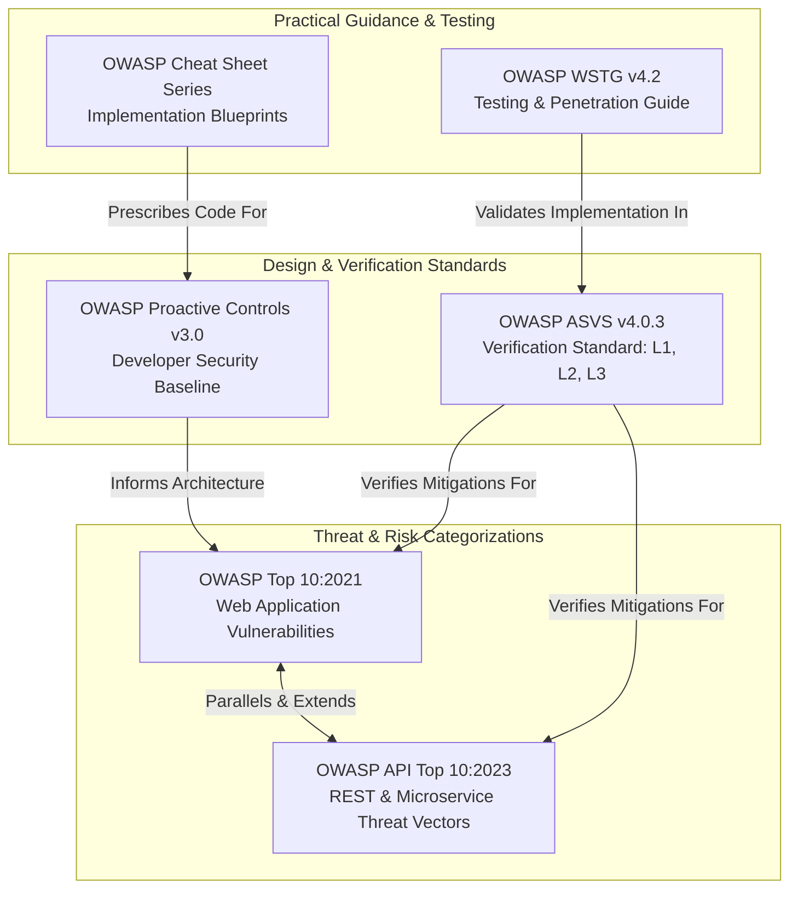

# OWASP SECURITY FRAMEWORK ALIGNMENT & REFERENCE COMPENDIUM
**Cross-Standard Mapping: OWASP Top 10:2021, API Security Top 10:2023, ASVS v4.0.3, and Proactive Controls**

---

## 1. Executive Framework Architecture
The Open Worldwide Application Security Project (OWASP) provides industry-standard benchmarks, methodologies, and verification frameworks for web application security. This reference compendium unifies four complementary OWASP standards to provide development and security teams with an integrated compliance and engineering model.

---

## 2. OWASP Top 10:2021 vs. 2017 Evolution Analysis
The 2021 release of the OWASP Top 10 marked a structural shift toward root-cause architectural weaknesses rather than purely symptomatic presentation flaws.

| 2021 Rank & Category | 2017 Rank | Evolution Summary & Architectural Drivers | Primary Root Causes |
|:---|:---:|:---|:---|
| **A01:2021 - Broken Access Control** | #5 | Climbed 4 spots to become the #1 most pervasive risk. 94% of tested applications exhibited some form of broken access control. | Decentralized auth checks, BOLA/IDOR in single-page apps and microservices, improper CORS, forced browsing. |
| **A02:2021 - Cryptographic Failures** | #3 | Formerly "Sensitive Data Exposure." Refocused on root cause (cryptographic failure) rather than symptom (data exposure). | Hardcoded secrets, weak PRNGs, deprecated ciphers (RC4, DES), missing TLS enforcement, plain HTTP cookies. |
| **A03:2021 - Injection** | #1 | Dropped to #3 as modern frameworks (ORMs, parameterized interfaces) gained market adoption; however, XSS was merged into this category. | Dynamic query concatenation, untrusted DOM manipulation, unescaped template rendering, OS command calls. |
| **A04:2021 - Insecure Design** | **NEW** | Brand-new category focusing on pre-coding flaws, architectural omissions, and lack of threat modeling. | Missing business logic validation, lack of tenant isolation, failure to anticipate adversarial user journeys. |
| **A05:2021 - Security Misconfiguration** | #6 | Climbed to #5 due to increased cloud migration and highly complex infrastructure-as-code deployments. | Unhardened cloud storage, default credentials, verbose error pages, open unnecessary ports/methods. |
| **A06:2021 - Vulnerable and Outdated Components** | #9 | Climbed 3 spots due to rampant open-source supply chain attacks (e.g., Log4Shell, event-stream). | Stale dependency trees, lack of automated SCA, unmaintained third-party libraries, missing SBOMs. |
| **A07:2021 - Identification and Authentication Failures** | #2 | Formerly "Broken Authentication." Dropped from #2 due to standard identity frameworks (OAuth2/OIDC, managed auth). | Missing MFA, weak password complexity, credential stuffing vulnerability, improper session token expiration. |
| **A08:2021 - Software and Data Integrity Failures** | **NEW** | New category focusing on code pipeline integrity, unsigned updates, and untrusted deserialization. | Insecure CI/CD pipelines, untrusted binary deserialization (Java/Python pickle), unverified package registry downloads. |
| **A09:2021 - Security Logging and Monitoring Failures** | #10 | Formerly "Insufficient Logging & Monitoring." Focuses on detectability of ongoing enterprise breaches. | Lack of security event logging, missing SIEM ingestion, unmonitored authentication failures, log tampering. |
| **A10:2021 - Server-Side Request Forgery (SSRF)** | **NEW** | Community-driven new entry due to cloud prevalence where SSRF enables exfiltration of link-local metadata credentials. | Backend web clients fetching arbitrary URLs without subnet validation or DNS pinning; unhardened cloud IMDS. |

---

## 3. OWASP API Security Top 10 (2023 Edition) Mapping
As API-first and decoupled single-page architectures dominate modern engineering, the OWASP API Security Top 10 highlights API-specific attack vectors.

| API Category | Description & Real-World Example | Primary Verification Focus |
|:---|:---|:---|
| **API1:2023 - Broken Object Level Authorization (BOLA)** | Manipulating IDs in API requests (`GET /users/501/orders`) to access unauthorized tenant records. | Ensure every data-access function cross-checks object ownership against token context. |
| **API2:2023 - Broken Authentication** | Token forgery, weak signature validation (`none` algorithm), unexpired JWTs, missing brute-force protections. | Verify signature algorithms, invalidate revoked tokens, implement strict session expiration. |
| **API3:2023 - Broken Object Property Level Authorization (BOPLA)** | Mass assignment or excessive data exposure where an endpoint accepts or serializes unpermitted object properties. | Implement explicit Data Transfer Objects (DTOs) and request schema allowlisting. |
| **API4:2023 - Unrestricted Resource Consumption** | Lack of rate limits or unbounded page size requests (`/api/records?limit=1000000`) leading to DoS. | Enforce gateway rate limiting, query pagination caps, and request execution timeouts. |
| **API5:2023 - Broken Function Level Authorization (BFLA)** | Regular users invoking administrative endpoints (`PUT /api/admin/roles`) due to shallow URL-path checks. | Enforce role-based access checks declaratively at the routing and controller layer. |
| **API6:2023 - Unrestricted Access to Sensitive Business Flows** | Bots automating purchase flows, coupon redemption, or ticket scalping at scale without rate or behavior gates. | Deploy bot-management controls, CAPTCHA on sensitive flows, and behavioral anomaly detection. |
| **API7:2023 - Server-Side Request Forgery (SSRF)** | Webhook configurations or file importers accepting user-supplied URLs that ping internal services. | Restrict egress via DNS resolution validation and network perimeter segmentation. |
| **API8:2023 - Security Misconfiguration** | Unprotected CORS wildcards (`*`), verbose stack traces in JSON responses, unhandled exceptions. | Standardize JSON error responses; disable debug mode; enforce security headers. |
| **API9:2023 - Improper Inventory Management** | Shadow APIs, deprecated v1 endpoints left exposed without current security controls, unpatched beta routes. | Maintain OpenAPI/Swagger catalogs; decommission zombie API versions automatically. |
| **API10:2023 - Unsafe Consumption of APIs** | Blindly trusting responses from third-party APIs without sanitization, assuming partner APIs are secure. | Validate and sanitize all incoming payloads from upstream partner services. |

---

## 4. OWASP Application Security Verification Standard (ASVS v4.0.3) Mapping

The ASVS defines three rigorous verification levels:
- **Level 1 (Opportunistic)**: Automated & baseline security verification without source access.
- **Level 2 (Standard Enterprise - Recommended Baseline)**: Comprehensive threat resistance for applications handling sensitive business data, PII, or financial transactions.
- **Level 3 (Advanced / Critical Infrastructure)**: High-assurance validation for defense, healthcare, and critical financial ledgers.

| ASVS Chapter | Domain Focus | Essential Verification Requirements (Level 2 Baseline) |
|:---|:---|:---|
| **V1: Architecture** | Security Architecture & Threat Modeling | V1.1.1: Threat modeling performed. V1.4.1: Trust boundaries explicitly defined across microservices. |
| **V2: Authentication** | Password Storage & Credential Management | V2.1.1: Passwords checked against known breach dictionaries. V2.4.1: Argon2id or bcrypt used for password hashing. V2.8.1: Generic error messages on login failures ("Invalid credentials"). |
| **V3: Session Management** | Token & Session Hygiene | V3.2.1: Session tokens generated with cryptographically secure PRNG ($\ge 128$ bits entropy). V3.4.1: Cookies set with `Secure; HttpOnly; SameSite=Strict`. V3.5.1: Session tokens invalidated upon logout and password reset. |
| **V4: Access Control** | Authorization & Scoping | V4.1.1: Access controls enforced at server-side, not relying on client UI hiding. V4.2.1: BOLA/IDOR prevention via tenant-scoped object validation. V4.3.1: Anti-CSRF tokens for all state-changing operations. |
| **V5: Validation & Encoding** | Injection & XSS Neutralization | V5.1.1: Positive input validation (allowlist regex). V5.2.1: Context-aware output encoding to prevent XSS. V5.3.1: Parameterized queries used exclusively for database operations. |
| **V6: Cryptography** | Algorithms & Key Management | V6.2.1: Industry-standard symmetric (AES-256-GCM) and asymmetric (RSA-4096 / Ed25519) ciphers. V6.4.1: Secrets stored in hardware security modules or dedicated KMS. |
| **V7: Logging & Auditing** | Security Observability | V7.1.1: All authentication, authorization, and administrative events logged. V7.2.1: Sensitive data (passwords, tokens, PII) masked from logs. V7.3.1: Log injection prevented via newline and control character sanitization. |
| **V8: Data Protection** | Data in Transit & Rest | V8.1.1: Sensitive data encrypted at rest. V8.3.1: Client-side browser caching disabled for sensitive endpoints (`Cache-Control: no-store`). |
| **V9: Communications** | Transport Layer Security | V9.1.1: TLS 1.3 enforced (or TLS 1.2 with PFS ciphers). V9.2.1: HSTS enforced with long duration and preload flag. |
| **V10: Malicious Code** | Code Integrity & Deserialization | V10.2.1: Untrusted deserialization strictly avoided. V10.3.1: External libraries loaded with Subresource Integrity (SRI) hashes. |
| **V11: Business Logic** | Abuse & Flow Integrity | V11.1.1: Business transactions executed sequentially without bypass. V11.2.1: Rate limiting enforced on critical business workflows. |
| **V12: File & Resources** | Uploads & SSRF Defense | V12.1.1: Uploaded files stored outside web root with randomized names. V12.6.1: Outbound HTTP requests restricted to validated public IPs. |
| **V13: API & Web Service** | REST & GraphQL Verification | V13.1.1: Schemas validated against JSON/OpenAPI definitions. V13.2.1: CORS restricted strictly to approved domains. |
| **V14: Configuration** | Build & Deployment Hardening | V14.1.1: Unnecessary HTTP methods (TRACE, OPTIONS) disabled. V14.4.1: Content-Security-Policy, X-Content-Type-Options, and X-Frame-Options configured. |

---

## 5. OWASP Proactive Controls (2018/2024 Reference)
The OWASP Top 10 focuses on risks; the OWASP Proactive Controls focus on defensive development practices:

- **C1: Define Security Requirements**: Establish security epics and user stories during sprint planning.
- **C2: Leverage Security Frameworks and Libraries**: Utilize hardened enterprise frameworks (Spring Security, Django Auth, Helmet.js).
- **C3: Secure Database Access**: Enforce parameterized queries, ORM safety, and least-privilege DB roles.
- **C4: Encode and Escape Data**: Neutralize injection across all output contexts (HTML, JavaScript, CSS, SQL, Shell).
- **C5: Validate All Inputs**: Validate data types, lengths, formats, and allowed character sets at system boundaries.
- **C6: Implement Digital Identity**: Deploy multi-factor authentication, secure session storage, and rate limiting.
- **C7: Enforce Access Controls**: Deny by default; centralize authorization in decoupled policy engines.
- **C8: Protect Data Everywhere**: Encrypt sensitive data in transit (TLS 1.3) and at rest (AES-GCM-256) with managed keys.
- **C9: Implement Security Logging and Monitoring**: Capture structured security events and integrate with incident response pipelines.
- **C10: Handle Errors and Exceptions**: Avoid exposing stack traces; return sanitized, user-friendly error codes.

---

## 6. Curated OWASP Cheat Sheet Index for Implementers

| Vulnerability / Domain | OWASP Cheat Sheet Reference Link | Key Developer Takeaway |
|:---|:---|:---|
| **SQL Injection** | [SQL Injection Prevention Cheat Sheet](https://cheatsheetseries.owasp.org/cheatsheets/SQL_Injection_Prevention_Cheat_Sheet.html) | Prepared statements guarantee code and data separation regardless of input content. |
| **Cross-Site Scripting** | [Cross Site Scripting Prevention Cheat Sheet](https://cheatsheetseries.owasp.org/cheatsheets/Cross_Site_Scripting_Prevention_Cheat_Sheet.html) | Context-dependent encoding: HTML body vs. HTML attribute vs. JavaScript context. |
| **Authentication** | [Authentication Cheat Sheet](https://cheatsheetseries.owasp.org/cheatsheets/Authentication_Cheat_Sheet.html) | Generic failure responses, MFA enforcement, and secure password reset workflows. |
| **Password Storage** | [Password Storage Cheat Sheet](https://cheatsheetseries.owasp.org/cheatsheets/Password_Storage_Cheat_Sheet.html) | Argon2id is current gold standard; bcrypt with factor $\ge 12$ is enterprise minimum. |
| **Session Management** | [Session Management Cheat Sheet](https://cheatsheetseries.owasp.org/cheatsheets/Session_Management_Cheat_Sheet.html) | Regenerate token on privilege changes; set `HttpOnly`, `Secure`, `SameSite=Strict`. |
| **REST Security** | [REST Security Cheat Sheet](https://cheatsheetseries.owasp.org/cheatsheets/REST_Security_Cheat_Sheet.html) | Use standard HTTP status codes, enforce HTTPS, validate content types, and limit rate. |
| **Authorization / BOLA** | [Authorization Cheat Sheet](https://cheatsheetseries.owasp.org/cheatsheets/Authorization_Cheat_Sheet.html) | Deny by default; check authorization on every request; never rely on obscurity. |
| **SSRF Prevention** | [Server-Side Request Forgery Prevention Cheat Sheet](https://cheatsheetseries.owasp.org/cheatsheets/Server_Side_Request_Forgery_Prevention_Cheat_Sheet.html) | Parse URL, resolve DNS, verify non-routable IP, and disable protocol redirection. |
| **Security Headers** | [Secure Headers Quick Reference Guide](https://cheatsheetseries.owasp.org/cheatsheets/Secure_Headers_Quick_Reference_Guide.html) | Always deploy HSTS, CSP, X-Content-Type-Options, X-Frame-Options, and Referrer-Policy. |
| **Input Validation** | [Input Validation Cheat Sheet](https://cheatsheetseries.owasp.org/cheatsheets/Input_Validation_Cheat_Sheet.html) | Whitelisting over blacklisting; validate on server side; enforce strict syntax & semantics. |
