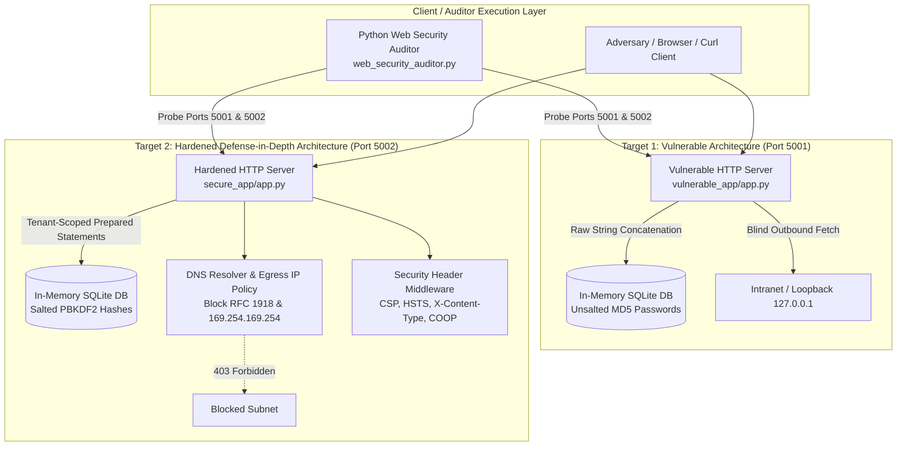
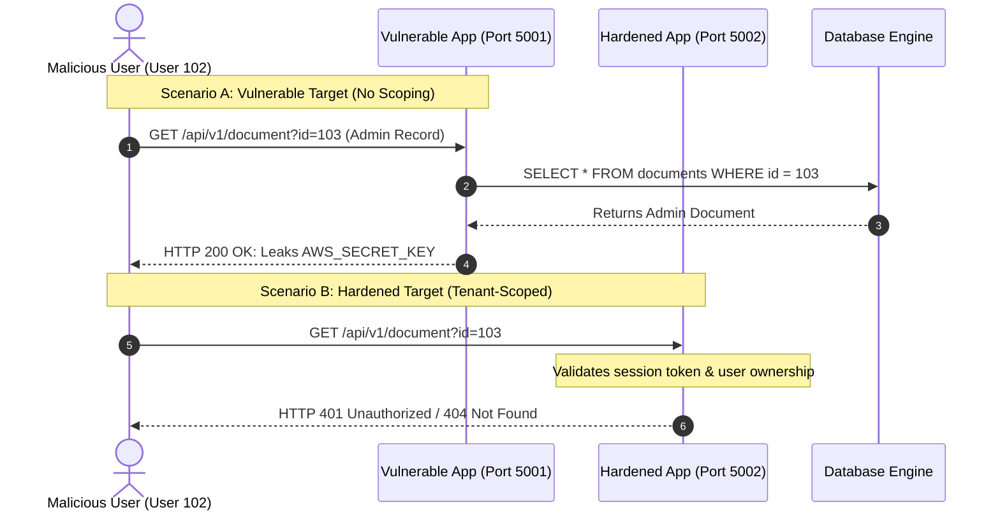
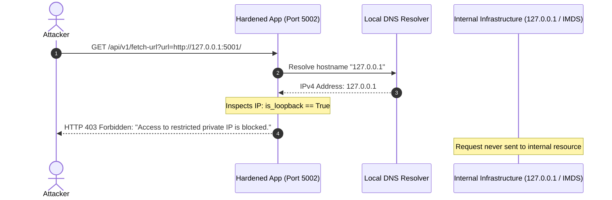

# ARCHITECTURE SPECIFICATIONS & EMPIRICAL EVIDENCE COMPENDIUM
**Web Application Security Research: Laboratory Architecture, Attack Flow Visuals, and Execution Logs**

---

## 1. System Architecture & Component Interactions



---

## 2. Attack Sequence Diagrams

### 2.1 Broken Object Level Authorization (BOLA) Attack vs. Defense



### 2.2 Server-Side Request Forgery (SSRF) Attack vs. Defense



---

## 3. Terminal Execution Logs (Raw Test Output)

The following raw execution transcript was recorded during automated test execution on the system:

```text
================================================================================
STARTING EMPIRICAL LAB EVALUATION: VULNERABLE VS. HARDENED TARGETS
================================================================================
[*] Launching Vulnerable Application Server on port 5001...
[*] Launching Hardened Application Server on port 5002...
[+] Both test servers active and responsive.

--------------------------------------------------------------------------------
PHASE 1: AUDITING VULNERABLE TARGET (http://127.0.0.1:5001)
--------------------------------------------------------------------------------
[-] Vulnerable Target Scan Completed.
[-] Score: 7.7%
[-] Total Findings: 12 (Failures)
[-] Passed Checks: 1
    * [HIGH] Missing HTTP Header: Content-Security-Policy (CWE: CWE-16 | ASVS: V14.4.1)
    * [HIGH] Missing HTTP Header: Strict-Transport-Security (CWE: CWE-16 | ASVS: V9.2.1)
    * [MEDIUM] Missing HTTP Header: X-Content-Type-Options (CWE: CWE-16 | ASVS: V14.4.2)
    * [MEDIUM] Missing HTTP Header: X-Frame-Options (CWE: CWE-16 | ASVS: V14.4.3)
    * [LOW] Missing HTTP Header: Referrer-Policy (CWE: CWE-16 | ASVS: V14.4.4)
    * [LOW] Missing HTTP Header: Permissions-Policy (CWE: CWE-16 | ASVS: V14.4.5)
    * [LOW] Server Banner Information Disclosure (CWE: CWE-200 | ASVS: V14.1.3)
    * [MEDIUM] Insecure CORS Wildcard Allowed (CWE: CWE-942 | ASVS: V14.4.5)
    * [HIGH] Session Cookie Missing 'HttpOnly' Flag (CWE: CWE-1004 | ASVS: V3.4.1)
    * [MEDIUM] Session Cookie Missing 'SameSite' Attribute (CWE: CWE-1275 | ASVS: V3.4.2)
    * [CRITICAL] Broken Object Level Authorization (BOLA / IDOR) Detected (CWE: CWE-639 | ASVS: V4.2.1)
    * [CRITICAL] SQL Injection & Raw Query Reflection Detected (CWE: CWE-89 | ASVS: V5.3.1)

--------------------------------------------------------------------------------
PHASE 2: AUDITING HARDENED TARGET (http://127.0.0.1:5002)
--------------------------------------------------------------------------------
[+] Hardened Target Scan Completed.
[+] Score: 100.0%
[+] Total Findings: 0 (Failures)
[+] Passed Checks: 13
    * [PASS] Header Present: Content-Security-Policy
    * [PASS] Header Present: Strict-Transport-Security
    * [PASS] Header Present: X-Content-Type-Options
    * [PASS] Header Present: X-Frame-Options
    * [PASS] Header Present: Referrer-Policy
    * [PASS] Header Present: Permissions-Policy
    * [PASS] Server Header Hardened
    * [PASS] Cookie HttpOnly Enforced
    * [PASS] Cookie Secure Enforced
    * [PASS] Cookie SameSite Enforced
    * [PASS] BOLA / IDOR Access Control Verified
    * [PASS] SQL Parameterization Confirmed
    * [PASS] SSRF Egress Defense Confirmed

================================================================================
[+] Benchmark artifacts successfully generated in: .../lab/benchmarks
[+] Comparative Report: .../lab/benchmarks/comparative_audit_report.md
================================================================================
[*] Terminating test server processes...
[+] Test servers stopped cleanly.
```
